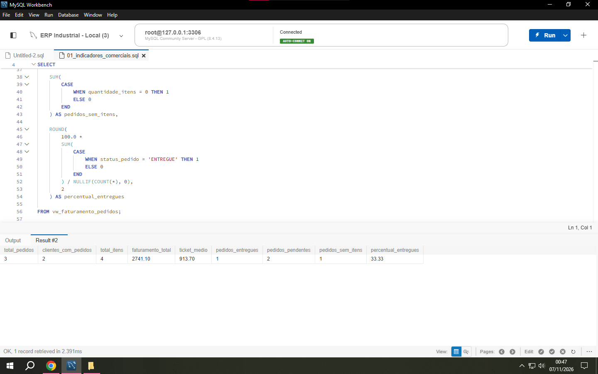
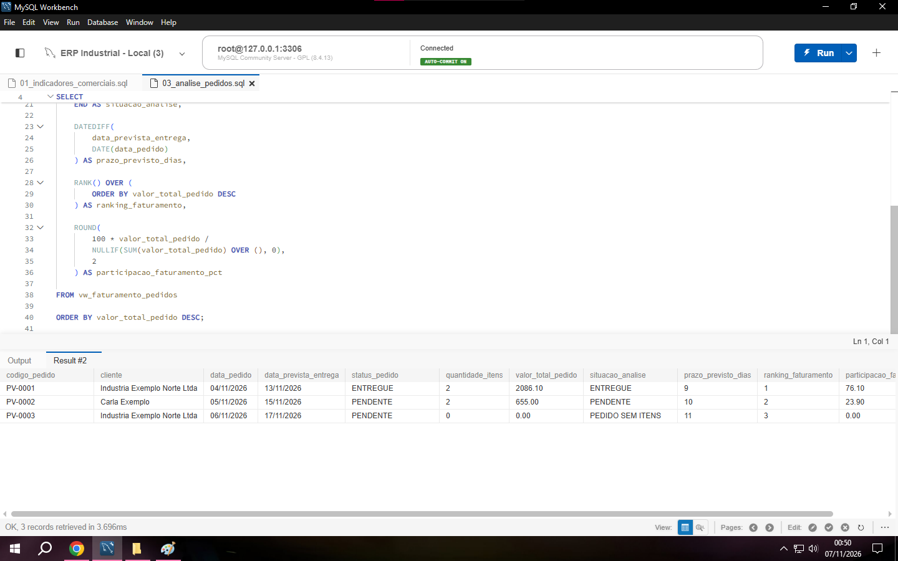
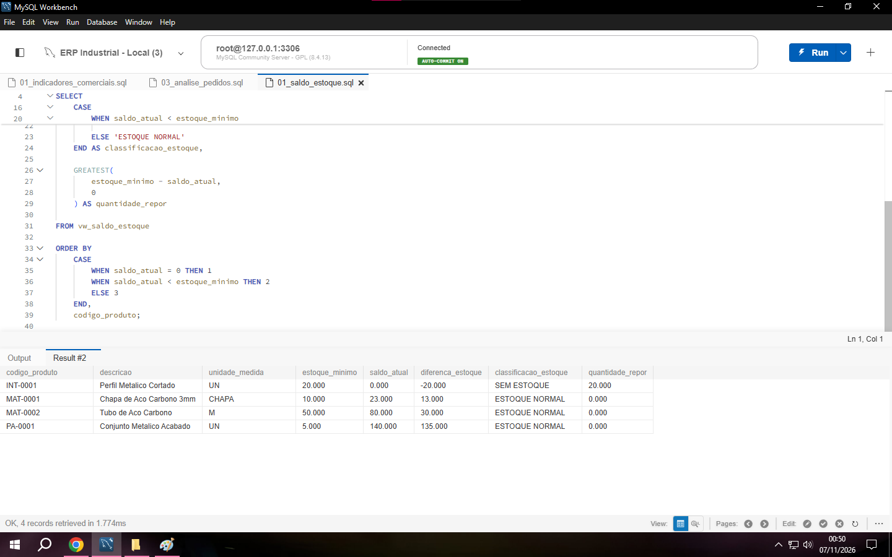
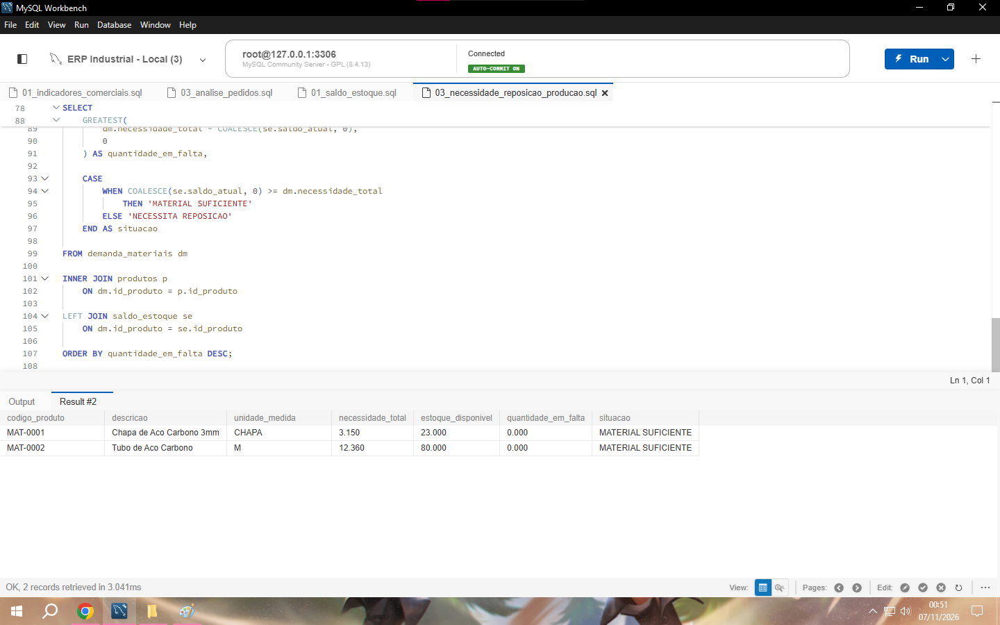
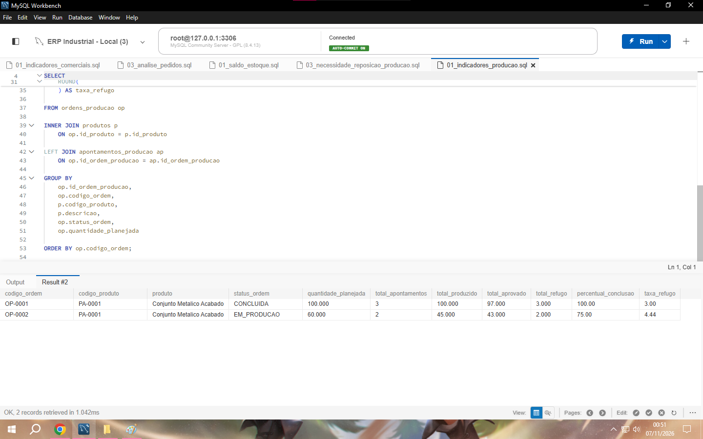
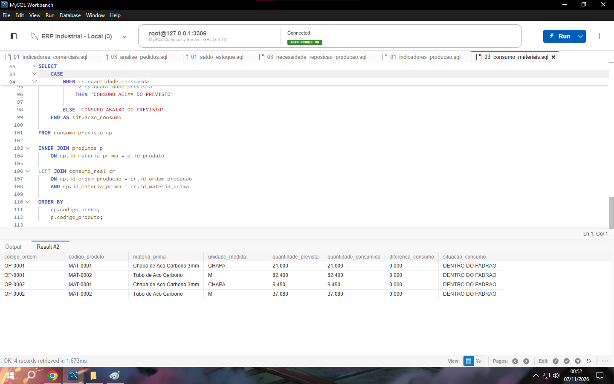

# ERP Industrial Analytics | Projeto de Análise de Dados com SQL

## Sobre o projeto

Projeto de análise de dados desenvolvido em MySQL, simulando um ambiente ERP de uma indústria.

O objetivo é demonstrar como SQL pode ser aplicado para estruturar dados operacionais, construir indicadores e responder a perguntas de negócio relacionadas às áreas comercial, estoque e produção.

O projeto utiliza uma base de dados didática com informações fictícias, permitindo explorar situações comuns da rotina industrial sem expor dados reais de empresas.

## Objetivos de negócio

**Comercial**
- Analisar faturamento e ticket médio.
- Identificar clientes com maior participação na receita.
- Classificar pedidos por situação.
- Analisar prazos e desempenho dos pedidos.

**Estoque**
- Consultar saldos atuais dos produtos.
- Identificar materiais abaixo do estoque mínimo.
- Consolidar entradas e saídas.
- Calcular necessidades de reposição.

**Produção**
- Monitorar ordens de produção.
- Analisar produtividade e taxa de refugo.
- Comparar produção planejada e realizada.
- Calcular necessidade de matéria-prima.
- Comparar consumo previsto e consumo registrado.

## Tecnologias utilizadas

- MySQL 8.4
- MySQL Workbench
- SQL

## Estrutura do projeto

```text
ERP-Industrial-Analytics/
│
├── projeto_integrador/
│   │
│   ├── 01_comercial/
│   │   ├── 01_indicadores_comerciais.sql
│   │   ├── 02_faturamento_por_cliente.sql
│   │   └── 03_analise_pedidos.sql
│   │
│   ├── 02_estoque/
│   │   ├── 01_saldo_estoque.sql
│   │   ├── 02_movimentacoes_estoque.sql
│   │   └── 03_necessidade_reposicao_producao.sql
│   │
│   └── 03_producao/
│       ├── 01_indicadores_producao.sql
│       ├── 02_qualidade_produtividade.sql
│       └── 03_consumo_materiais.sql
│
├── evidencias/
│
└── README.md
```

## Modelagem de dados

O banco de dados contempla entidades relacionadas às operações de uma indústria:

- Clientes e fornecedores.
- Produtos e estrutura de produtos (BOM).
- Pedidos de venda e compra.
- Itens dos pedidos.
- Movimentações de estoque.
- Ordens de produção.
- Apontamentos de produção.

Também foram utilizadas views para simplificar consultas analíticas, como `vw_faturamento_pedidos` e `vw_saldo_estoque`.

## Principais conceitos SQL aplicados

| Conceito | Aplicação |
|---|---|
| SELECT, WHERE e ORDER BY | Consulta e organização dos dados |
| INNER JOIN e LEFT JOIN | Relacionamento entre tabelas |
| GROUP BY e HAVING | Agregação e filtros |
| SUM, COUNT e AVG | Indicadores e métricas |
| CASE WHEN | Classificação de situações de negócio |
| COALESCE e NULLIF | Tratamento de valores nulos e divisão por zero |
| CTE (WITH) | Organização de consultas complexas |
| Subqueries | Comparação com médias e indicadores |
| RANK e DENSE_RANK | Classificação e ordenação analítica |
| Window Functions | Faturamento acumulado e médias móveis |
| DATEDIFF | Análise de prazos |
| EXPLAIN e EXPLAIN ANALYZE | Análise de execução |
| CREATE INDEX | Otimização de consultas |

## Exemplos de análises desenvolvidas

**1. Indicadores comerciais**

Consolidação de pedidos, faturamento, ticket médio e percentual de entregas.

**2. Faturamento por cliente**

Identificação da participação de cada cliente no faturamento total.

**3. Controle de estoque**

Classificação de produtos conforme estoque mínimo e cálculo de quantidade sugerida para reposição.

**4. Planejamento de materiais**

Comparação entre a necessidade de matérias-primas das ordens de produção e o estoque disponível, considerando perdas previstas na estrutura dos produtos.

**5. Indicadores de produção**

Análise de quantidade produzida, aprovada, refugos, percentual de conclusão e produtividade por hora.

**6. Consumo de matéria-prima**

Comparação entre consumo teórico e movimentações efetivamente registradas no estoque.

## Resultados e aprendizado

O projeto permitiu aplicar SQL em cenários de análise operacional e desenvolver consultas voltadas à transformação de dados em informações para tomada de decisão.

Além da construção de indicadores, foram explorados relacionamentos entre entidades, tratamento de inconsistências, regras de negócio e fundamentos de otimização de consultas.

## Sobre

Projeto desenvolvido para demonstrar conhecimentos práticos em SQL, modelagem relacional e análise de dados aplicados ao contexto industrial.

## Evidências das análises

As imagens abaixo documentam a execução das consultas SQL e os resultados obtidos no MySQL Workbench.

<details>
<summary>01 — Indicadores comerciais</summary>



</details>

<details>
<summary>02 — Análise de pedidos</summary>



</details>

<details>
<summary>03 — Saldo de estoque</summary>



</details>

<details>
<summary>04 — Necessidade de materiais</summary>



</details>

<details>
<summary>05 — Indicadores de produção</summary>



</details>

<details>
<summary>06 — Consumo de materiais</summary>



</details>